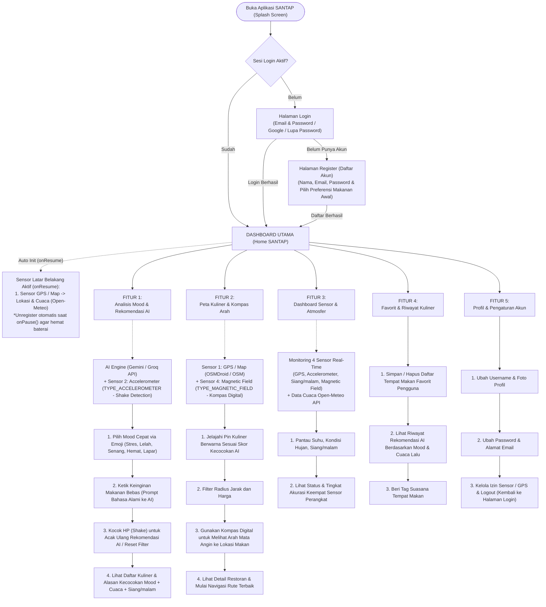
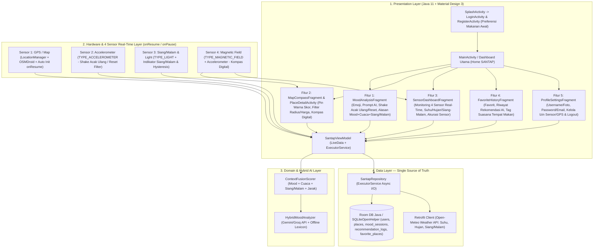
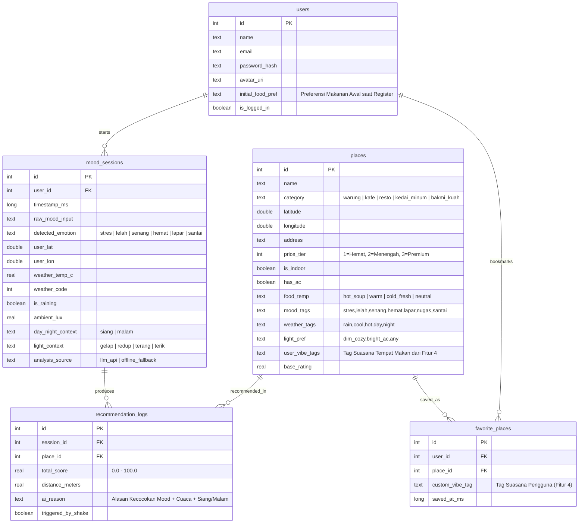
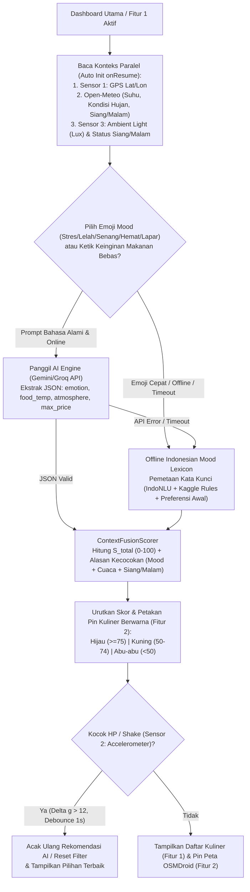

# SANTAP — Single Source of Truth (SSOT)

> **Sistem Analisis Tempat Makan Berdasarkan Atmosfer & Perasaan (*Context-Aware Culinary Recommendation App for Android*)**

---

## 0. Kontrol Dokumen dan Tata Kelola SSOT

| Atribut Dokumen | Detail |
|---|---|
| **Kode & Versi Dokumen** | `SANTAP-SSOT-v1.3` |
| **Status Penguncian** | **LOCKED SSOT v1.3** *(Diselaraskan dengan diagram alur resmi folder `Rancangan`; Identitas tim 3 anggota terkunci; Bahasa: **Java Native (Java 11)** — Acuan resmi kode Android Studio, Milestone, PPT, dan Live Demo)* |
| **Tanggal Pembaruan Terakhir** | 27 November 2026 |
| **Mata Kuliah & Penugasan** | Final Project Pemrograman Mobile (Semester 5 — Android Studio Native) |
| **Jadwal Presentasi & Demo** | **9 Desember 2026** di hadapan Dosen & Asisten *(Catatan jadwal: pertemuan 2 Desember 2026 hanya absen)* |
| **Dokumen Rancangan Alur** | [alur aplikasi santap.jpeg](file:///d:/Institut%20Teknologi%20Sepuluh%20Nopember/Semester%205/Pemrograman%20Mobile/Final%20Project/Rancangan/alur%20aplikasi%20santap.jpeg) & [alur_aplikasi_santap.drawio (1).xml](file:///d:/Institut%20Teknologi%20Sepuluh%20Nopember/Semester%205/Pemrograman%20Mobile/Final%20Project/Rancangan/alur_aplikasi_santap.drawio%20(1).xml) |
| **Dokumen Sumber Konsep** | [Analisis 5W+1H Aplikasi SANTAP](file:///c:/Users/rayha/OneDrive/Documents/SEMESTER%205/5.%20Pemrograman%20Mobile/FP%20PEMMOB/Analisis%205W+1H%20Aplikasi%20SANTAP%20(Sistem%20Analisis%20Tempat%20Makan%20Berdasarkan%20Atmosfer%20&%20Perasaan).md) |
| **Acuan Praktikum Kuliah** | [Tugas7Sensor README.md](file:///c:/Users/rayha/OneDrive/Documents/SEMESTER%205/5.%20Pemrograman%20Mobile/2.%20Tugas/Tugas7Sensor/README.md) & Modul `GPSAPP` (`osmdroid-android`) |

### Aturan Tata Kelola Satu Sumber Kebenaran (*Governance Rules*)
1. **Satu Fakta, Satu Tempat (*Single Point of Definition*):** Seluruh landasan jurnal ilmiah, rujukan dataset, spesifikasi sensor perkuliahan, dan target performa dikunci tunggal pada **Bagian 2 (Master Fact Sheet)** dengan pengenal unik (`F-01` s.d. `F-13`). Seluruh slide PPT dan penjelasan saat tanya jawab wajib merujuk konsisten pada angka dan definisi tersebut.
2. **Pemisahan Tegas Fakta Terverifikasi vs Target Rencana:**
   - Klaim berstatus `VERIFIED` mengacu pada literatur ber-DOI terverifikasi, dataset publik yang tersedia, dan spesifikasi kode praktikum kelas (`Tugas7Sensor` / `GPSAPP`).
   - Klaim berstatus `TARGET` atau `PLANNED` merupakan sasaran implementasi menuju demo 9 Desember 2026 dan **tidak boleh** diklaim sebagai pengujian yang sudah selesai sebelum diuji langsung pada perangkat uji.
3. **Prosedur Perubahan:** Setiap perubahan daftar sensor, rumus skor, atau ruang lingkup fitur MVP wajib memperbarui Bagian 2 (Master Fact Sheet), Bagian 7 (Scope Triage), dan Bagian 8.2 (Architecture Decision Log) terlebih dahulu sebelum memodifikasi kode atau slide presentasi.

### Riwayat Revisi (*Changelog*)

| Versi | Tanggal | Ringkasan Perubahan Substantif |
|---|---|---|
| `v0.1` | Pra-25 Nov 2026 | Penyusunan konsep awal 5W+1H **SANTAP** berbasis Web/PWA (Leaflet/MapLibre, PostgreSQL PostGIS, Open-Meteo, LLM API). |
| `v1.0` | 25 Nov 2026 | Penyelarasan penuh konsep SANTAP menjadi proyek **Android Studio Native** untuk Final Project Pemrograman Mobile: penguncian 4 sensor inti + 1 sensor bonus, peta **OpenStreetMap (`osmdroid`)**, Room DB sebagai SSOT klien, pengayaan 9 jurnal ilmiah ber-DOI & 5 sumber dataset (Kaggle/IndoNLU/Open Data), serta penyusunan blueprint 7 slide PPT & skenario Live Demo 9 Desember 2026. |
| `v1.1` | 25 Nov 2026 | **Penguncian Bahasa Java Native (Java 11)** sesuai kesepakatan tim: pembaruan arsitektur MVVM ke `LiveData` + `ExecutorService` (menggantikan `StateFlow`), dukungan opsi Room Java `annotationProcessor` / `SQLiteOpenHelper`, penyelarasan detail teknis `osmdroid` (`setUserAgentValue`, `LocationListener`, default koordinat Surabaya) dari `GPSAPP`, serta penambahan `ADR-006` (*Code Pattern Reuse* dari `Tugas7Sensor`). |
| `v1.2` | 25 Nov 2026 | Pengisian identitas resmi **3 anggota kelompok** (`Rayhan Agnan Kusuma`, `Ni'mah Fauziyyah Atok`, `M. Faqih Ridho`), penyeimbangan ulang PIC fitur pada Scope Triage, serta penambahan **Peta Milestone (`M0`–`M5`) & Checklist Eksekusi** di Bagian 12 menuju demo 9 Desember 2026. |
| `v1.3` | 27 Nov 2026 | **Penyelarasan Penuh dengan Diagram Folder `Rancangan` (`alur aplikasi santap.jpeg` & `.drawio.xml`):** (1) Penambahan alur **Splash Screen $\to$ Cek Sesi Login $\to$ Halaman Login & Register (dengan Preferensi Makanan Awal) $\to$ Dashboard Utama (Home SANTAP)**; (2) Penguncian **5 Fitur Utama** (Fitur 1: Analisis Mood & Rekomendasi AI, Fitur 2: Peta Kuliner & Kompas Arah, Fitur 3: Dashboard Sensor & Atmosfer, Fitur 4: Favorit & Riwayat Kuliner + Beri Tag Suasana, Fitur 5: Profil & Pengaturan Akun); (3) Penyesuaian **Auto-Init Sensor Latar Belakang (`onResume`/`onPause`)** untuk GPS/Map $\to$ Lokasi & Cuaca Open-Meteo; (4) Penyelarasan parameter konteks **Mood + Cuaca + Siang/Malam** (`TYPE_LIGHT` + indikator Siang/Malam) serta fungsi **Kocok HP (Shake)** untuk *Acak Ulang Rekomendasi AI / Reset Filter*. |

---

## Daftar Isi

1. [Identitas Proyek, Ketentuan FP, dan Kepatuhan Silabus](#1-identitas-proyek-ketentuan-fp-dan-kepatuhan-silabus)
2. [Master Fact Sheet](#2-master-fact-sheet)
3. [Analisis Masalah & 5W+1H Terstruktur](#3-analisis-masalah--5w1h-terstruktur)
4. [Inventaris Dataset & Landasan Jurnal Ilmiah](#4-inventaris-dataset--landasan-jurnal-ilmiah)
5. [Spesifikasi Sensor Android & Kepatuhan 5 Prinsip Emas Kuliah](#5-spesifikasi-sensor-android--kepatuhan-5-prinsip-emas-kuliah)
6. [Target Pengguna, Alur Kerja Utama, dan Diferensiasi](#6-target-pengguna-alur-kerja-utama-dan-diferensiasi)
7. [Cakupan Fitur, Scope Triage (P0 / P1 / P2), dan Batasan Ruang Lingkup](#7-cakupan-fitur-scope-triage-p0--p1--p2-dan-batasan-ruang-lingkup)
8. [Arsitektur Teknis Android & Architecture Decision Log (ADR)](#8-arsitektur-teknis-android--architecture-decision-log-adr)
9. [Model Data Relasional (Room Database Schema)](#9-model-data-relasional-room-database-schema)
10. [Logika Inti Analisis Atmosfer, Emosi, dan Rumus Penilaian](#10-logika-inti-analisis-atmosfer-emosi-dan-rumus-penilaian)
11. [Privasi, Keamanan Kredensial, dan Manajemen Risiko Demo](#11-privasi-keamanan-kredensial-dan-manajemen-risiko-demo)
12. [Milestone Pembuatan Aplikasi & Timeline Eksekusi (25 November – 9 Desember 2026)](#12-milestone-pembuatan-aplikasi--timeline-eksekusi-25-november--9-desember-2026)
13. [Blueprint Presentasi PPT (7 Slide) & Skenario Live Demo](#13-blueprint-presentasi-ppt-7-slide--skenario-live-demo)
14. [Strategi Pertahanan Tanya Jawab (Q&A Dosen & Asisten)](#14-strategi-pertahanan-tanya-jawab-qa-dosen--asisten)
15. [Daftar Pustaka, Dataset, dan Referensi Terverifikasi](#15-daftar-pustaka-dataset-dan-referensi-terverifikasi)

---

## 1. Identitas Proyek, Ketentuan FP, dan Kepatuhan Silabus

### 1.1 Parameter Utama Proyek

| Parameter | Nilai Terkunci |
|---|---|
| **Nama Aplikasi** | **SANTAP** (*Sistem Analisis Tempat Makan Berdasarkan Atmosfer & Perasaan*) |
| **Platform & IDE** | **Android Native** — Android Studio (**Java 11 / Java Native**, XML Views + Material Design 3, `minSdk 24`) |
| **Peta & Geolokasi** | **OpenStreetMap** melalui pustaka `osmdroid-android` + `LocationManager` / `LocationListener` (`Auto Init` saat `onResume()` untuk Lokasi & Cuaca Open-Meteo, `removeUpdates`/unregister otomatis di `onPause()` agar hemat baterai, koordinat awal Surabaya `-7.2575, 112.7521` selaras dengan modul kelas `GPSAPP`) |
| **Sensor Terintegrasi** | **4 Sensor Real-Time + 1 Sensor Bonus:** (1) **Sensor 1: GPS / Map** (Lokasi & Cuaca Open-Meteo), (2) **Sensor 2: Accelerometer** (`TYPE_ACCELEROMETER` — Shake Detection untuk Acak Ulang Rekomendasi AI / Reset Filter), (3) **Sensor 3: Siang/Malam & Ambient Light** (`TYPE_LIGHT` + Konteks Siang/Malam), (4) **Sensor 4: Magnetic Field / Kompas Digital** (`TYPE_MAGNETIC_FIELD` + `TYPE_ACCELEROMETER` — Arah Mata Angin ke Lokasi Makan), dan (5) Step Counter (`TYPE_STEP_COUNTER` — Opsional) |
| **Mesin Konteks & AI** | Hybrid Engine: **Open-Meteo Weather API** (Suhu, Kondisi Hujan, Siang/Malam) + **LLM API (Gemini / Groq)** dengan **Offline Lexicon & Deterministic Scorer Fallback** (`ExecutorService` + `LiveData`) |
| **Penyimpanan Lokal (SSOT)** | **Room Database** (`annotationProcessor` Java, dengan alternatif sah `SQLiteOpenHelper` / `DbHelper.java` sesuai `Tugas 4–6`) berisi *pre-populated seed* kuliner, sesi akun & preferensi makanan awal, favorit + tag suasana tempat makan, serta riwayat rekomendasi AI |
| **Status Keaslian Kode** | Proyek baru untuk Final Project Pemrograman Mobile dengan mengadopsi pola arsitektur sensor & peta yang telah diajarkan di perkuliahan |

### 1.2 Checklist Kepatuhan Catatan Kelompok Final Project

> [!IMPORTANT]
> Seluruh poin catatan kelompok wajib terpenuhi 100% sebelum presentasi di hadapan dosen dan asisten pada **9 Desember 2026**.

| No | Ketentuan Catatan Kelompok FP | Implementasi Terkunci di SANTAP | Status |
|:-:|:---|:---|:---:|
| 1 | **Minimal 3 sensor** & wajib **1 Maps/GPS** (boleh pakai OpenStreetMap) | Memakai **4 sensor inti aktif** (`GPS/Location`, `Accelerometer`, `Ambient Light`, `Magnetometer/Compass Fusion`) + `1 bonus (Step Counter)` serta peta interaktif **OpenStreetMap (`osmdroid`)**. | `TERPENUHI` |
| 2 | **Memanfaatkan sensor yang pernah diajarkan** di perkuliahan | Mengadopsi langsung pola dari materi `Android_Studio_Sensor_Kuliah.pptx` & `Tugas7Sensor`: *Shake Detection + Debounce*, *Ambient Light Auto Dark Mode + Hysteresis*, *Digital Compass Fusion* (`getRotationMatrix` + `getOrientation`), serta *5 Prinsip Emas Sensor*. | `TERPENUHI` |
| 3 | **Jadwal:** Mingdep (**2 Des 2026**) hanya absen; Presentasi ke dosen & asisten tgl **9 Desember 2026** | Jadwal kerja dibagi ke dalam **Sprint 1 (25 Nov – 1 Des)**, **Checkpoint Absen (2 Des)**, **Sprint 2 (3–6 Des)**, **Freeze & Gladi (7–8 Des)**, dan **Presentasi & Live Demo (9 Des)**. | `TERJADWAL` |
| 4 | **Presentasi minimal 5 slide PPT** (membuat apa, tujuan, sensor apa saja yang digunakan) | Disusun blueprint **7 slide terstruktur** (melampaui batas minimal 5 slide) yang menjawab tegas: *apa yang dibuat*, *tujuan & urgensi ilmiah*, *sensor & peta yang dipakai*, *AI/dataset*, serta *skenario demo*. | `TERPENUHI` |
| 5 | **Mendemokan aplikasi yang berjalan** (*Live Demo*) | APK terinstal di HP Android fisik + *screen mirroring* (`scrcpy`/USB) dengan skenario demo 5 aksi nyata sensor + *Offline Fallback Mode* jika sinyal ruang kelas terganggu. | `TARGET` |

### 1.3 Identitas Anggota Kelompok *(Terkunci — 3 Anggota)*

| Nama Lengkap | NRP | Peran Teknis di SANTAP | Tanggung Jawab Utama *(Selaras 5 Fitur Rancangan)* |
|---|---|---|---|
| **M. Faqih Ridho** | `5027241123` | **Team Lead — Auth, UI/UX, Fitur 4–5 & QA/PPT** | Koordinasi tim, alur **Splash Screen, Login & Register (Preferensi Makanan Awal)**, **Dashboard Utama (Home SANTAP)**, **Fitur 4 (Favorit, Riwayat & Tag Suasana)**, **Fitur 5 (Profil, Kelola Izin Sensor/GPS & Logout)**, `Implicit Intent` rute & bagikan, serta penyusunan 7 slide PPT & orkestrasi demo |
| **Rayhan Agnan Kusuma** | `502724101` | **Map & Multi-Sensor Engineer (Fitur 2 & 3)** | **Sensor Latar Belakang (`onResume`/`onPause`)**, **Fitur 2 (Peta Kuliner OSMDroid, Pin Warna Skor, Filter Radius/Harga & Kompas Digital Arah Mata Angin `TYPE_MAGNETIC_FIELD`)**, **Sensor 2 Accelerometer Shake** (Acak Ulang Rekomendasi / Reset Filter), serta **Fitur 3 (Dashboard Monitoring 4 Sensor Real-Time & Akurasi Sensor)** |
| **Ni'mah Fauziyyah Atok** | `502724102` | **AI, Weather API & Local Data Engineer (Fitur 1 & Data)** | **Fitur 1 (Analisis Mood Emoji/Prompt Bahasa Alami ke AI Gemini/Groq & Alasan Kecocokan Mood + Cuaca + Siang/Malam)**, integrasi **Open-Meteo API** (Suhu, Kondisi Hujan, Siang/Malam), serta **Room DB / `SQLiteOpenHelper` (SSOT)** beserta *seed* 30–50 POI kuliner |

---

## 2. Master Fact Sheet

Seluruh landasan ilmiah, spesifikasi dataset, dan metrik target proyek SANTAP dikunci dalam tabel berikut:

| Fact ID | Kategori | Pernyataan / Nilai Terkunci | Sumber / Artefak Bukti | Status |
|---|---|---|---|---|
| `F-01` | Psikologi Keputusan (*Choice Overload*) | Terlalu banyak pilihan (*choice overload*) menurunkan motivasi memilih dan kepuasan pasca-keputusan (studi klasik selai oleh Iyengar & Lepper, 2000; dikonfirmasi meta-analisis Chernev et al., 2015 yang mengidentifikasi kompleksitas pilihan dan ketidakpastian preferensi sebagai pemicu utama). | Iyengar & Lepper (2000), DOI `10.1037/0022-3514.79.6.995`; Chernev et al. (2015), DOI `10.1016/j.jcps.2014.08.002` | `VERIFIED` |
| `F-02` | *Decision Fatigue* Kuliner | Pemilihan menu dan makanan rentan mengalami kelebihan pilihan (*menu overload*, Johns et al., 2013) serta **kelelahan keputusan (*decision fatigue*) yang dipengaruhi oleh waktu hari** dalam eksperimen pemilihan makanan daring (Olsen et al., 2017). | Johns et al. (2013), DOI `10.1080/15428052.2013.798564`; Olsen et al. (2017), DOI `10.1108/BFJ-05-2016-0227` | `VERIFIED` |
| `F-03` | Psikologi Emosi & *Comfort Food* | Keadaan emosional dan stres memengaruhi pemilihan makanan melalui jalur psikologis-fisiologis (Gibson, 2006); pemakan emosional memilih *comfort food* yang sangat enak (*palatable*) untuk meredakan suasana hati negatif dalam jangka pendek (Van Strien et al., 2019). | Gibson (2006), DOI `10.1016/j.physbeh.2006.01.024`; Van Strien et al. (2019), DOI `10.1016/j.physbeh.2019.112671` | `VERIFIED` |
| `F-04` | Dampak Pencahayaan (*Ambient Light*) | Pencahayaan lingkungan (*ambient light*) terbukti memengaruhi tingkat kewaspadaan mental dan pilihan makanan konsumen dalam studi eksperimental *Journal of Marketing Research* (Biswas et al., 2017) — menjadi justifikasi ilmiah pemanfaatan `Sensor.TYPE_LIGHT`. | Biswas, Szocs, Chacko, & Wansink (2017), DOI `10.1509/jmr.14.0115` | `VERIFIED` |
| `F-05` | Sistem Rekomendasi Kontekstual (CARS) | *Context-Aware Recommender Systems* (Adomavicius et al., 2022) dan *Food Recommender Systems* (Elsweiler, Hauptmann, & Trattner, 2022) menegaskan bahwa penggabungan konteks real-time (lokasi, waktu, cuaca, kondisi pengguna) krusial untuk relevansi rekomendasi dan mengatasi *cold-start*. | Adomavicius et al. (2022), DOI `10.1007/978-1-0716-2197-4_6`; Elsweiler et al. (2022), DOI `10.1007/978-1-0716-2197-4_23` | `VERIFIED` |
| `F-06` | Korpus NLP Emosi Bahasa Indonesia | Benchmark **IndoNLU** (Wilie et al., 2020) menyediakan dataset **EmoT** (`Saputri et al., 2018` — 5 label emosi percakapan Indonesia: `anger`, `fear`, `happy`, `love`, `sadness`) dan **SmSA** (sentimen teks termasuk ulasan tempat makan/warung) untuk memetakan ekspresi curhat pengguna Indonesia. | Wilie et al. (2020), DOI `10.18653/v1/2020.aacl-main.85`; Saputri et al. (2018), DOI `10.1109/IALP.2018.8629262` | `VERIFIED` |
| `F-07` | Dataset Mahasiswa & *Comfort Food* | Dataset Kaggle **"Food choices" (BoraPajo)** berisi survei mahasiswa yang secara eksplisit memasangkan variabel **comfort food** dengan kondisi **mood** (stres, bosan, sedih, senang) sebagai rujukan aturan *Mood-to-Food*. | Kaggle Dataset `Food choices` (BoraPajo) | `VERIFIED` |
| `F-08` | Dataset Kuliner Indonesia & Open API | Tersedia dataset **All Restaurants in Jakarta**, **Indonesian Food and Drink Nutrition Dataset** (>1.300 item), dan **Indonesian Food Recipes Dataset** di Kaggle, dipadukan dengan data spasial **OpenStreetMap Overpass API** serta cuaca real-time **Open-Meteo API** (tanpa biaya/API key). | Kaggle Datasets + OpenStreetMap Overpass API + Open-Meteo API | `VERIFIED` |
| `F-09` | Spesifikasi Algoritma Sensor Kuliah | Acuan resmi modul praktikum `Tugas7Sensor`: (1) **Shake Detection:** $\text{Mag} = \sqrt{x^2+y^2+z^2}$, $\Delta = |\text{Mag} - 9.81|$, debounce `1000 ms`; (2) **Light Hysteresis:** `< 10 Lux` Dark Mode, `> 80 Lux` Light Mode, `10–80 Lux` *deadband*; (3) **Compass Fusion:** `TYPE_ACCELEROMETER` + `TYPE_MAGNETIC_FIELD` via `getRotationMatrix()` & `getOrientation()`. | [Tugas7Sensor README.md](file:///c:/Users/rayha/OneDrive/Documents/SEMESTER%205/5.%20Pemrograman%20Mobile/2.%20Tugas/Tugas7Sensor/README.md) & `Android_Studio_Sensor_Kuliah.pptx` | `VERIFIED` |
| `F-10` | Target Cakupan POI Lokal Demo | **Target MVP Demo:** Basis data lokal Room menyimpan minimal **30–50 titik tempat makan nyata** di sekitar kawasan kampus/kota uji yang telah diperkaya tag atmosfer (`is_indoor`, `has_ac`, `price_tier`, `mood_tags`, `weather_tags`). | Kurasi Overpass API + Kaggle untuk `Seed` Room DB | `TARGET` |
| `F-11` | Target Latensi Rekomendasi | **Target MVP Demo:** Penghitungan skor konteks lokal (*Offline/Rule Fallback*) berjalan dalam **$< 300\text{ ms}$**, sedangkan mode analisis AI daring (Gemini/Groq + Open-Meteo) merespons dalam **$\le 2,5\text{ detik}$**. | Uji performa log Android Studio Logcat pada sprint 2 | `TARGET` |
| `F-12` | Target Kestabilan Sensor & Daya | **Target MVP Demo:** Nol *memory leak* / *crash* saat rotasi layar atau keluar aplikasi (`unregisterListener` wajib di `onPause()`), tidak ada pemicu *shake* berulang dalam jendela `1000 ms`, dan seluruh fitur perangkat keras dideklarasikan `android:required="false"`. | Audit `AndroidManifest.xml` & Lifecycle UI | `TARGET` |
| `F-13` | Target Kesiapan Demo 9 Desember | **Target MVP Demo:** Minimal **1 alur ujung-ke-ujung (*end-to-end*)** berjalan mulus di HP fisik + *screen mirroring* dengan cadangan *Offline Demo Mode* (tanpa bergantung penuh pada kestabilan Wi-Fi ruang kelas). | Skenario Gladi Demo Bagian 13.2 | `TARGET` |

---

## 3. Analisis Masalah & 5W+1H Terstruktur

Bagian ini mengonsolidasikan konsep dari dokumen awal tim ([Analisis 5W+1H Aplikasi SANTAP](file:///c:/Users/rayha/OneDrive/Documents/SEMESTER%205/5.%20Pemrograman%20Mobile/FP%20PEMMOB/Analisis%205W+1H%20Aplikasi%20SANTAP%20(Sistem%20Analisis%20Tempat%20Makan%20Berdasarkan%20Atmosfer%20&%20Perasaan).md)) dengan penguatan fakta ilmiah (`F-01`–`F-05`) dan implementasi sensor Android Studio.

### 3.1 Ringkasan 5W+1H Pemanfaatan SANTAP

| Dimensi | Uraian Terstruktur | Keterkaitan Teknis & Fakta |
|---|---|---|
| **WHAT** *(Apa)* | **SANTAP** adalah aplikasi Android *native* pemetaan kuliner cerdas berbasis konteks (*Context-Aware Culinary Recommender*) yang memadukan **sensor perangkat keras HP** (GPS, Accelerometer, Ambient Light, Magnetometer), **cuaca real-time**, dan **AI analisis perasaan (*mood*)** untuk merekomendasikan tempat makan terdekat beserta skor kecocokannya. | Mengimplementasikan CARS (`F-05`) di Android Studio dengan peta `osmdroid`. |
| **WHY** *(Mengapa)* | 1. **Keterbatasan Peta Konvensional:** Aplikasi peta/pesan-antar hanya menyaring jarak, rating, dan harga tanpa membaca suasana hati atau kondisi atmosfer pengguna. 2. **Decision Fatigue & Choice Overload:** Kebingungan *"hari ini mau makan apa ya?"* membuang waktu pengguna ketika dihadapkan pada puluhan opsi (`F-01`, `F-02`). 3. **Pengaruh Emosi & Lingkungan:** Hujan deras, terik matahari, pencahayaan sekitar, serta stres/lelah langsung mengubah preferensi makanan dan kenyamanan tempat (`F-03`, `F-04`). | Fitur *Mood-to-Food* + *Shake-to-SANTAP* memutus kelumpuhan keputusan secara instan. |
| **WHO** *(Siapa)* | 1. **Mahasiswa & Pekerja Muda:** Mobilitas tinggi, sering makan di luar dengan anggaran tertentu, rentan mengalami *decision fatigue* di sela jam kuliah/kerja. 2. **Pendatang & Wisatawan:** Belum hafal kuliner sekitar namun ingin tempat yang cocok dengan cuaca dan *mood* saat itu. 3. **Pelaku UMKM Kuliner Lokal:** Warung, kedai, dan kafe lokal mendapat eksposur berdasarkan keunggulan suasana (*indoor/AC*, *berkuah hangat*, *nyaman untuk nugas*) bukan hanya iklan berbayar. | Persona utama & sekunder pada Bagian 6.1. |
| **WHERE** *(Di mana)* | Diterapkan pada kawasan urban padat kuliner (sekitar kampus, kos mahasiswa, kawasan perkantoran, pusat kota) melalui aplikasi **Android Native** berbasis layanan lokasi GPS & peta OpenStreetMap (`osmdroid`). | Fokus *seed* POI awal 30–50 kuliner nyata di radius area kampus/kota uji (`F-10`). |
| **WHEN** *(Kapan)* | Digunakan pada jam makan harian (sarapan, makan siang, makan malam, kuliner larut malam), saat terjadi perubahan cuaca mendadak (hujan/panas terik), atau momen emosional tertentu (stres tugas, lelah berjalan, ingin *nongkrong*). | Didukung deteksi waktu sistem & `Sensor.TYPE_LIGHT` + `Open-Meteo`. |
| **HOW** *(Bagaimana)* | 1. Pengguna membuka **Splash Screen**, melakukan **Login / Register** (dengan memilih **Preferensi Makanan Awal**), lalu masuk ke **Dashboard Utama (Home SANTAP)** yang otomatis mengaktifkan sensor latar belakang (`onResume`) untuk **GPS/Map $\to$ Lokasi & Cuaca Open-Meteo** (*unregister* otomatis saat `onPause()`). 2. **Fitur 1 (Analisis Mood & Rekomendasi AI):** Pengguna memilih **Mood Cepat via Emoji** (*Stres, Lelah, Senang, Hemat, Lapar*), mengetik keinginan makanan bebas ke AI, atau **Mengocok HP (Shake - `TYPE_ACCELEROMETER`)** untuk mengacak ulang rekomendasi AI / mereset filter, lalu melihat daftar kuliner & alasan kecocokan **Mood + Cuaca + Siang/Malam**. 3. **Fitur 2 (Peta Kuliner & Kompas Arah):** Menjelajahi pin kuliner berwarna sesuai skor kecocokan AI, memfilter radius jarak & harga, serta menggunakan **Kompas Digital (`TYPE_MAGNETIC_FIELD`)** untuk melihat arah mata angin ke lokasi makan & navigasi rute terbaik. 4. **Fitur 3, 4 & 5:** Memantau suhu, kondisi hujan, siang/malam & status akurasi 4 sensor di **Dashboard Sensor & Atmosfer (Fitur 3)**, mengelola favorit/riwayat & **memberi tag suasana tempat makan (Fitur 4)**, serta mengatur profil, izin sensor/GPS, dan logout di **Profil & Pengaturan Akun (Fitur 5)**. | Memenuhi seluruh ketentuan sensor, OpenStreetMap (`F-09`), & diagram alur `Rancangan`. |

---

## 4. Inventaris Dataset & Landasan Jurnal Ilmiah

### 4.1 Matriks Jurnal Ilmiah Relevan (9 Referensi Terverifikasi)

Seluruh jurnal di bawah ini menjadi fondasi ilmiah bagi fitur AI, sensor, dan pemetaan SANTAP:

| No | Penulis & Tahun | Judul & Publikasi | DOI / Tautan Resmi | Relevansi Langsung ke Fitur SANTAP |
|:-:|:---|:---|:---|:---|
| 1 | **Iyengar & Lepper (2000)** | *When choice is demotivating: Can one desire too much of a good thing?* — *Journal of Personality and Social Psychology* | `10.1037/0022-3514.79.6.995` | Landasan konsep *choice overload* (`F-01`) yang menjelaskan mengapa daftar restoran terlalu banyak justru membuat pengguna gagal memilih. |
| 2 | **Chernev, Böckenholt, & Goodman (2015)** | *Choice overload: A conceptual review and meta-analysis* — *Journal of Consumer Psychology* | `10.1016/j.jcps.2014.08.002` | Menunjukkan bahwa penyaringan berdasar preferensi dan pengurangan kompleksitas opsi mengatasi *choice overload* (`F-01`). |
| 3 | **Johns, Edwards, & Hartwell (2013)** | *Menu Choice: Satisfaction or Overload?* — *Journal of Culinary Science & Technology* | `10.1080/15428052.2013.798564` | Membuktikan fenomena kelebihan opsi terjadi langsung pada konteks pemilihan makanan/menu restoran (`F-02`). |
| 4 | **Olsen et al. (2017)** | *The Influence of Time of Day on Decision Fatigue in Online Food Choice Experiments* — *British Food Journal* | `10.1108/BFJ-05-2016-0227` | Memvalidasi bahwa **waktu hari** memengaruhi tingkat kelelahan keputusan saat memilih makanan (`F-02`), mendukung fitur penyesuaian konteks waktu + *Shake-to-SANTAP*. |
| 5 | **Gibson (2006)** | *Emotional influences on food choice: sensory, physiological and psychological pathways* — *Physiology & Behavior* | `10.1016/j.physbeh.2006.01.024` | Menjelaskan mekanisme stres dan suasana hati dalam mengarahkan selera makan individu (`F-03`). |
| 6 | **Van Strien et al. (2019)** | *Is comfort food actually comforting for emotional eaters? A (moderated) mediation analysis* — *Physiology & Behavior* | `10.1016/j.physbeh.2019.112671` | Membuktikan keterkaitan antara kondisi emosi negatif dengan pencarian *comfort food* untuk regulasi suasana hati (`F-03`). |
| 7 | **Biswas, Szocs, Chacko, & Wansink (2017)** | *Shining Light on Atmospherics: How Ambient Light Influences Food Choices* — *Journal of Marketing Research* | `10.1509/jmr.14.0115` | **Kunci Sensor Cahaya (`F-04`):** Membuktikan intensitas pencahayaan sekitar memengaruhi kewaspadaan dan pilihan makanan — menjadi argumen akademik paling kuat mengapa SANTAP memakai `Sensor.TYPE_LIGHT`. |
| 8 | **Adomavicius et al. (2022)** | *Context-Aware Recommender Systems: From Foundations to Recent Developments* — *Recommender Systems Handbook* (3rd Ed.) | `10.1007/978-1-0716-2197-4_6` | Kerangka teoretis *Context-Aware Recommender Systems (CARS)* untuk menggabungkan konteks lokasi, waktu, cuaca, dan kondisi pengguna (`F-05`). |
| 9 | **Elsweiler, Hauptmann, & Trattner (2022)** | *Food Recommender Systems* — *Recommender Systems Handbook* (3rd Ed.) | `10.1007/978-1-0716-2197-4_23` | Membahas tantangan khusus sistem rekomendasi kuliner (konteks waktu, preferensi spontan, dan *cold-start*) (`F-05`). |

*(Referensi pendukung NLP Indonesia untuk pemetaan emosi teks: **Wilie et al., 2020** — IndoNLU, DOI `10.18653/v1/2020.aacl-main.85` dan **Saputri et al., 2018** — Indonesian Twitter Emotion Dataset, DOI `10.1109/IALP.2018.8629262` [`F-06`]).*

### 4.2 Inventaris Dataset Relevan (Kaggle, IndoNLU, & Open Data)

Karena aplikasi Android berjalan untuk kuliner lokal Indonesia dengan kombinasi analisis teks emosi dan kondisi lingkungan, dataset dikurasi dari **5 sumber terverifikasi**:

| No | Nama Dataset & Sumber | Isi & Struktur Data Utama | Cara Pemanfaatan di SANTAP |
|:-:|:---|:---|:---|
| 1 | **Kaggle — `Food choices` (BoraPajo)** | Data survei mahasiswa mencakup jenis *comfort food*, alasan emosional (`stress`, `boredom`, `sadness`, `happiness`), kebiasaan makan, dan preferensi rasa (`F-07`). | Menjadi dasar penyusunan **Matriks Aturan & Prompting *Mood-to-Food*** (contoh: emosi `stres/lelah` $\to$ bobot tinggi untuk kategori *comfort food hangat/manis*; emosi `bosan` $\to$ kategori *pedas/unik/eksplorasi*). |
| 2 | **IndoNLU — `EmoT` & `SmSA` (`indonlp/indonlu` / Kaggle Mirrors)** | **EmoT** (`Saputri et al., 2018`): teks percakapan Indonesia berlabel emosi (`anger`, `fear`, `happy`, `love`, `sadness`). **SmSA**: kalimat ulasan Indonesia termasuk ulasan restoran/warung (`F-06`). | Digunakan sebagai acuan kosakata emosi gaul/informal Indonesia pada **Offline Indonesian Mood Lexicon** dan validasi *few-shot prompt* AI agar paham curhat mahasiswa (misal *"pusing tugas"*, *"mager"*, *"gabut"*, *"butuh yang seger"*). |
| 3 | **Kaggle — `All Restaurants in Jakarta` & `Indonesian Food and Drink Nutrition Dataset`** | Daftar restoran Indonesia beserta koordinat, kategori hidangan, rentang harga, serta >1.300 item makanan/minuman lokal beserta profil nutrisi (`F-08`). | Dipakai untuk menyusun **Taksonomi Kuliner Indonesia** (pengelompokan menu berkuah hangat, minuman dingin/kafe, makanan berat hemat, kudapan manis) serta memperkaya label atribut tempat makan. |
| 4 | **OpenStreetMap — Overpass API (`amenity=restaurant\|cafe\|fast_food\|food_court`)** | Titik koordinat geografis nyata (`lat`, `lon`), nama tempat, jenis tempat makan, dan alamat jalan di wilayah sekitar kampus/kota uji (`F-08`). | Diekstrak saat fase penyiapan data untuk membangun **Pre-Populated Seed 30–50 POI Kuliner Nyata** di dalam Room Database agar peta `osmdroid` akurat dengan lokasi demo di lapangan. |
| 5 | **Open-Meteo Weather API (Open Real-Time Data)** | Data cuaca *real-time* berdasarkan koordinat GPS (`temperature_2m`, `relative_humidity_2m`, `precipitation`, `weather_code` WMO) tanpa biaya & tanpa API key (`F-08`). | Dikonsumsi langsung via Retrofit setiap sesi pencarian untuk mengklasifikasikan atmosfer (`Hujan/Dingin`, `Sejuk/Berawan`, `Panas/Terik`) secara otomatis. |

> [!TIP]
> **Strategi Praktis 14 Hari:** Untuk menjamin keandalan demo 9 Desember, tim tidak melatih model *deep learning* raksasa dari nol di perangkat HP, melainkan memakai pendekatan **Knowledge Distillation dari Dataset ke Aturan + Hybrid LLM**: pola dari Kaggle `Food choices` dan `IndoNLU EmoT` ditransformasikan menjadi tabel bobot *Mood-to-Food* + kamus kata emosi lokal (*Offline Fallback*) serta panduan sistem (*system prompt*) bagi LLM API (Gemini/Groq), sementara POI sekitar kampus diambil dari Overpass API lalu disimpan lokal di Room DB.

---

## 5. Spesifikasi Sensor Android & Kepatuhan 5 Prinsip Emas Kuliah

### 5.1 Pemetaan Sensor Kuliah ke Fitur SANTAP

Berdasarkan materi `Android_Studio_Sensor_Kuliah.pptx` dan `Tugas7Sensor`, berikut 4 sensor inti + 1 sensor bonus yang diimplementasikan:

| No | Sensor / API Android (Sesuai Rancangan) | Kategori Materi | Mekanisme Kerja di SANTAP | Nilai Guna Langsung bagi Pengguna |
|:-:|:---|:---|:---|:---|
| 1 | **Sensor 1: GPS / Map** (`LocationManager` + `LocationListener`) + **OSMDroid** | **Wajib FP (GPS/Maps)** & **Sensor Latar Belakang (`onResume`)** | Aktif otomatis (*Auto Init*) saat `onResume()` di Dashboard Utama untuk mengambil lokasi & memicu data cuaca **Open-Meteo**, serta wajib `removeUpdates()` (*unregister* otomatis) saat `onPause()` agar hemat baterai. Memanggil `Configuration.getInstance().setUserAgentValue(getPackageName())`, menghitung jarak Haversine ke setiap POI, dan merender pin kuliner berwarna di `MapView` OpenStreetMap (titik awal Surabaya `-7.2575, 112.7521`). | Menampilkan posisi pengguna secara langsung, menyaring radius jarak & harga, serta menyusun peta kuliner berkode warna skor kecocokan AI (**Fitur 2 & 3**). |
| 2 | **Sensor 2: Accelerometer** (`Sensor.TYPE_ACCELEROMETER`) | **Motion Sensor** *(Studi Kasus 1: Shake Detection)* | Menghitung $\text{Mag} = \sqrt{x^2+y^2+z^2}$ dan $\Delta g = |\text{Mag} - 9.81\text{ m/s}^2|$. Jika $\Delta g > 12.0\text{ m/s}^2$ dan jeda *debounce* $\ge 1000\text{ ms}$, pemicu **Shake Detection** aktif. | **Fitur 1 & 3:** Kocok HP (*Shake*) untuk **mengacak ulang rekomendasi AI / mereset filter** serta menampilkan pilihan tempat makan terbaik anti-*decision fatigue*. |
| 3 | **Sensor 3: Siang/Malam & Ambient Light** (`Sensor.TYPE_LIGHT` + Indikator `Siang/Malam`) | **Environment Sensor** *(Studi Kasus 3: Light & Day/Night Context)* | Menggabungkan pembacaan intensitas cahaya sekitar (**Lux** dari `TYPE_LIGHT`) dengan status **Siang/Malam** (dari Open-Meteo `is_day` & jam perangkat): 1. **Konteks Siang/Malam & Atmosfer:** Menentukan alasan kecocokan kuliner berdasarkan **Mood + Cuaca + Siang/Malam**. 2. **Auto Dark Mode + Hysteresis:** `< 10 Lux` aktifkan Dark Mode; `> 80 Lux` aktifkan Light Mode; `10–80 Lux` *deadband* anti-kedip. | **Fitur 1 & 3:** Memantau kondisi **Siang/Malam** secara *real-time* di Dashboard Sensor & Atmosfer serta menyesuaikan rekomendasi tempat makan siang vs malam (`F-04`). |
| 4 | **Sensor 4: Magnetic Field / Kompas Digital** (`TYPE_MAGNETIC_FIELD` + `TYPE_ACCELEROMETER`) | **Position / Sensor Fusion** *(Studi Kasus 4: Digital Compass)* | Memanggil `SensorManager.getRotationMatrix()` dan `getOrientation()` untuk mendapatkan sudut **Azimuth** mata angin hadap HP, lalu membandingkannya dengan *bearing* GPS menuju lokasi makan terpilih. | **Fitur 2 & 3:** Menggunakan **Kompas Digital** untuk melihat arah mata angin & penunjuk arah *real-time* menuju lokasi tempat makan beserta status akurasi sensornya. |
| 5 | **Step Counter** (`Sensor.TYPE_STEP_COUNTER`) *(Bonus Opsional)* | **Activity / Motion Sensor** | Membaca akumulasi langkah kaki (dengan izin `ACTIVITY_RECOGNITION` pada Android 10+) sejak sesi berjalan. | Jika langkah pengguna tinggi/lelah berjalan, SANTAP memprioritaskan kuliner berjarak sangat dekat ($\le 400\text{ m}$). |

### 5.2 Checklist Penerapan 5 Prinsip Emas Perkuliahan Sensor (`F-09`)

Mengacu langsung pada Bagian VII Slide 27 perkuliahan dan `Tugas7Sensor/README.md`, kode SANTAP **wajib** memenuhi kelima prinsip berikut:

1. **Always Check Availability:** Setiap inisialisasi di `SensorController` wajib memeriksa `sensor != null` sebelum memanggil `registerListener()`. Jika sensor (misal magnetometer/light pada emulator) tidak ada, tampilkan status informatif dan gunakan nilai default yang aman tanpa *crash*.
2. **Match Delay to Use Case:** Seluruh sensor di SANTAP memakai `SensorManager.SENSOR_DELAY_UI` (cukup responsif untuk UI kompas, *shake*, dan cahaya, namun jauh lebih hemat baterai dibanding `SENSOR_DELAY_FASTEST`).
3. **Strict Lifecycle Hygiene:** Pendaftaran `registerListener()` hanya dijalankan pada `onResume()`, dan `unregisterListener()` **wajib** dipanggil pada `onPause()` pada Activity/Fragment terkait agar sensor tidak terus menyedot baterai di latar belakang.
4. **Zero Allocation in Callback:** Di dalam `onSensorChanged(SensorEvent event)`, dilarang membuat objek array baru (`new float[3]` / `new Object()`). Gunakan array anggota kelas yang dialokasikan sekali di awal dan salin menggunakan `System.arraycopy()`.
5. **Graceful Hardware Fallback & Optional Manifest:** Pada `AndroidManifest.xml`, seluruh deklarasi `<uses-feature>` sensor diset `android:required="false"` agar APK tetap dapat diinstal pada berbagai perangkat dan emulator uji.

---

## 6. Target Pengguna, Alur Kerja Utama, dan Diferensiasi

### 6.1 Target Pengguna (Persona)

| Persona | Karakteristik Utama | Masalah yang Dirasakan | Nilai Guna SANTAP |
|---|---|---|---|
| **1. Mahasiswa & Pekerja Muda** *(Pengguna Utama)* | Mobilitas tinggi, makan di luar bersama teman atau sendiri, sensitif harga dan waktu istirahat. | Sering terjebak kebingungan memilih tempat makan (*decision fatigue*) saat jam makan siang atau saat hujan sepulang kelas. | Mendapat rekomendasi cepat sesuai *mood*, dompet, dan cuaca hanya dalam beberapa detik atau 1x goyangan HP. |
| **2. Pendatang / Wisatawan** | Belum mengenal karakter kuliner lokal di sekitar lokasi menginap atau kunjungan. | Aplikasi peta hanya memberi daftar panjang berdasarkan rating tanpa tahu apakah tempat itu cocok untuk suasana santai, dingin, atau butuh tempat berteduh. | Menemukan kuliner lokal yang paling selaras dengan atmosfer lingkungan dan preferensi spontan mereka. |
| **3. Pelaku Usaha Kuliner (UMKM)** | Pemilik warung, kedai, atau kafe lokal yang bersaing dengan restoran berjaringan besar. | Kalah visibilitas dari restoran beriklan di aplikasi pesan-antar meskipun menawarkan suasana nyaman atau menu khas cuaca tertentu. | Berpeluang muncul di peringkat atas saat atmosfer & *mood* pengguna cocok dengan profil tempat mereka. |

### 6.2 Diagram Alur Aplikasi SANTAP *(Sesuai Folder `Rancangan`)*

> [!NOTE]
> Diagram di bawah ini merepresentasikan secara presisi rancangan visual di [alur aplikasi santap.jpeg](file:///d:/Institut%20Teknologi%20Sepuluh%20Nopember/Semester%205/Pemrograman%20Mobile/Final%20Project/Rancangan/alur%20aplikasi%20santap.jpeg) dan [alur_aplikasi_santap.drawio (1).xml](file:///d:/Institut%20Teknologi%20Sepuluh%20Nopember/Semester%205/Pemrograman%20Mobile/Final%20Project/Rancangan/alur_aplikasi_santap.drawio%20(1).xml).

### 6.3 Alur Kerja Utama (*Core User Journeys — Selaras 5 Fitur Rancangan*)

#### Journey 0 — Splash Screen, Autentikasi & Auto-Init Sensor Latar Belakang
1. Pengguna membuka aplikasi SANTAP (**Splash Screen**), lalu sistem memeriksa apakah **Sesi Login Aktif**.
2. Jika belum aktif, pengguna masuk ke **Halaman Login** (*Input Email & Password*, *Login via Google*, *Lupa Password*) atau berpindah ke **Halaman Register** (*Input Nama, Email & Password* serta **Pilih Preferensi Makanan Awal**).
3. Setelah sesi aktif, pengguna masuk ke **DASHBOARD UTAMA (Home SANTAP)**. Saat `onResume()`, aplikasi otomatis menginisialisasi **Sensor GPS / Map** untuk mendapatkan lokasi & cuaca terkini dari **Open-Meteo**, dan otomatis melakukan *unregister* saat `onPause()` agar hemat baterai.

#### Journey 1 (FITUR 1) — Analisis Mood & Rekomendasi AI + *Shake Detection* (`P0`)
1. Pengguna memilih **Mood Cepat via Emoji** (*Stres, Lelah, Senang, Hemat, Lapar*) atau mengetikkan **Keinginan Makanan Bebas** (*Prompt Bahasa Alami ke AI* Gemini/Groq, dengan *fallback* kamus lokal).
2. Pengguna dapat **Mengocok HP (*Shake* — Sensor 2: `TYPE_ACCELEROMETER`)** dengan $\Delta g > 12.0\text{ m/s}^2$ (debounce `1000 ms`) untuk **mengacak ulang rekomendasi AI / mereset filter** atau mengambil rekomendasi pilihan teratas secara cepat.
3. Aplikasi menampilkan **Daftar Kuliner & Alasan Kecocokan** berdasarkan perpaduan **Mood + Cuaca + Siang/Malam**.

#### Journey 2 (FITUR 2) — Peta Kuliner & Kompas Arah (`P0`)
1. Pengguna membuka peta interaktif OpenStreetMap (**Sensor 1: GPS / Map**) dan menjelajahi **Pin Kuliner Berwarna** sesuai skor kecocokan AI (Hijau $\ge 75$, Kuning $50–74$, Abu-abu $< 50$).
2. Pengguna dapat menyaring tempat makan menggunakan **Filter Radius Jarak dan Harga**.
3. Pengguna menggunakan **Kompas Digital (Sensor 4: `TYPE_MAGNETIC_FIELD` + `TYPE_ACCELEROMETER`)** untuk melihat **arah mata angin & jarum penunjuk arah** menuju lokasi makan.
4. Pengguna membuka **Detail Restoran** dan menekan tombol **Mulai Navigasi Rute Terbaik** (*Implicit Intent* `geo:lat,lon?q=...`).

#### Journey 3 (FITUR 3) — Dashboard Sensor & Atmosfer (`P0/P1`)
1. Pengguna membuka **Dashboard Sensor & Atmosfer** yang memonitor **4 Sensor Real-Time** (*GPS, Accelerometer, Siang/Malam [`TYPE_LIGHT`], Magnetic Field*) bersama data **Open-Meteo API**.
2. Pengguna memantau **Suhu, Kondisi Hujan, dan status Siang/Malam** saat itu, serta melihat **Status & Tingkat Akurasi Keempat Sensor Perangkat** secara transparan.

#### Journey 4 & 5 (FITUR 4 & FITUR 5) — Favorit, Riwayat, Tag Suasana & Profil Akun (`P1`)
1. Pada **Fitur 4 (Favorit & Riwayat Kuliner)**: Pengguna dapat menyimpan/menghapus daftar tempat makan favorit, melihat riwayat rekomendasi AI berdasarkan mood & cuaca lalu, serta **memberi Tag Suasana Tempat Makan**.
2. Pada **Fitur 5 (Profil & Pengaturan Akun)**: Pengguna dapat mengubah *Username & Foto Profil*, mengubah *Password & Alamat Email*, serta **mengelola izin Sensor/GPS & Logout** kembali ke Halaman Login.

### 6.4 Analisis Perbandingan Jujur terhadap Solusi Eksisting

| Platform | Kelebihan Faktual | Celah & Diferensiasi SANTAP |
|---|---|---|
| **Google Maps** | Basis data POI global sangat lengkap, rute belok-demi-belok akurat, ulasan banyak. | Penyaringan hanya berbasis jarak, rating, dan buka/tutup; tidak membaca **mood pengguna**, **cuaca real-time**, **pencahayaan sekitar**, serta tidak memiliki fitur *anti-decision fatigue* sekali goyang. |
| **GoFood / GrabFood** | Memudahkan pesan-antar makanan lengkap dengan promo dan pembayaran digital. | Berorientasi transaksi *delivery* dengan ratusan daftar yang memicu *choice overload*; tidak menganalisis kenyamanan atmosfer tempat untuk makan langsung (*dine-in*) maupun navigasi kompas. |
| **PergiKuliner / Zomato** | Kurasi ulasan kuliner dan foto suasana tempat cukup detail. | Bersifat pencarian direktori pasif; belum menggabungkan sensor perangkat keras ponsel (cahaya, guncangan, kompas) dan kecerdasan buatan penerjemah perasaan bebas. |

---

## 7. Cakupan Fitur, Scope Triage (P0 / P1 / P2), dan Batasan Ruang Lingkup

Seluruh fitur dari diagram alur pada folder `Rancangan` ([alur aplikasi santap.jpeg](file:///d:/Institut%20Teknologi%20Sepuluh%20Nopember/Semester%205/Pemrograman%20Mobile/Final%20Project/Rancangan/alur%20aplikasi%20santap.jpeg)) dipetakan ke dalam prioritas pengerjaan menuju **Live Demo 9 Desember 2026** (termasuk klasifikasi legenda **"Kalau sempet"** pada diagram):

| ID Fitur | Prioritas | Pilar Rancangan & Spesifikasi Fitur | PIC Utama | Target Selesai |
|---|---|---|---|---|
| `P0-01` | **P0 (Wajib Demo)** | **FITUR 2 — Peta Kuliner & Kompas Arah (`Sensor 1: GPS/Map` & `Sensor 4: Magnetic Field`):** • Auto-init GPS/Map saat `onResume()` & *unregister* saat `onPause()` • Jelajahi Pin Kuliner Berwarna sesuai skor kecocokan AI di `osmdroid` (`-7.2575, 112.7521`) • Filter Radius Jarak dan Harga • Kompas Digital (`TYPE_MAGNETIC_FIELD` + `TYPE_ACCELEROMETER`) melihat arah mata angin ke lokasi makan • Lihat Detail Restoran & Mulai Navigasi Rute Terbaik (*Implicit Intent*). | Rayhan | 30 Nov 2026 |
| `P0-02` | **P0 (Wajib Demo)** | **Open-Meteo Real-Time Weather & Day/Night Context:** Pengambilan Suhu, Kondisi Hujan, dan status **Siang/Malam** otomatis per koordinat GPS via Retrofit + penyimpanan cache lokal di SharedPreferences/Room. | Ni'mah | 29 Nov 2026 |
| `P0-03` | **P0 (Wajib Demo)** | **FITUR 3 — Dashboard Sensor & Atmosfer (Monitoring 4 Sensor Real-Time):** • Monitoring 4 Sensor Real-Time: **GPS**, **Accelerometer**, **Siang/Malam (`TYPE_LIGHT` + Jam/Cuaca)**, **Magnetic Field** + Cuaca Open-Meteo • Pantau Suhu, Kondisi Hujan, dan Siang/Malam • Lihat Status & Tingkat Akurasi Keempat Sensor Perangkat (mematuhi 5 Prinsip Emas Sensor). | Rayhan | 1 Des 2026 |
| `P0-04` | **P0 (Wajib Demo)** | **FITUR 1 — Analisis Mood & Rekomendasi AI + `Sensor 2: Accelerometer (Shake)`:** • Pilih Mood Cepat via Emoji (*Stres, Lelah, Senang, Hemat, Lapar*) • Ketik Keinginan Makanan Bebas (*Prompt Bahasa Alami ke AI Gemini/Groq* + *Offline Lexicon Fallback*) • **Kocok HP (Shake)** untuk **Acak Ulang Rekomendasi AI / Reset Filter** ($\Delta g > 12.0$, debounce `1000 ms`) • Lihat Daftar Kuliner & Alasan Kecocokan **Mood + Cuaca + Siang/Malam**. | Ni'mah + Rayhan | 3 Des 2026 |
| `P0-05` | **P0 (Wajib Demo)** | **Room Database SSOT (`annotationProcessor`) & Local Culinary Seed:** Skema Room Java (`users`, `places`, `mood_sessions`, `recommendation_logs`, `favorite_places`) berisi minimal **30–50 kuliner nyata sekitar kampus/kota uji** hasil ekstraksi Overpass API + atribut suasana. | Ni'mah | 28 Nov 2026 |
| `P0-06` | **P0 (Wajib Demo)** | **Splash Screen, Auth (Login/Register Lokal) & Dashboard Utama (Home SANTAP):** • Splash Screen $\to$ Cek Sesi Login Aktif (`SharedPreferences`) • Halaman Login (Email & Password) & Halaman Register (Nama, Email, Password + **Pilih Preferensi Makanan Awal**) • Navigasi utama ke 5 Fitur di Dashboard Utama (Home SANTAP). | Faqih | 4 Des 2026 |
| `P1-01` | **P1 (Nilai Tambah)** | **FITUR 4 — Favorit & Riwayat Kuliner:** • Simpan / Hapus Daftar Tempat Makan Favorit Pengguna • Lihat Riwayat Rekomendasi AI Berdasarkan Mood & Cuaca Lalu • **Beri Tag Suasana Tempat Makan** (disimpan di Room DB). | Faqih | 6 Des 2026 |
| `P1-02` | **P1 / "Kalau Sempet"** | **FITUR 5 — Profil & Pengaturan Akun + Opsi Auth Tambahan:** • Ubah Username & Foto Profil; Ubah Password & Alamat Email (Lokal) • Kelola Izin Sensor / GPS & Logout (Kembali ke Halaman Login) • *(Kategori "Kalau sempet" di legenda Rancangan)*: Tombol UI Login via Google / Lupa Password & bonus `TYPE_STEP_COUNTER`. | Faqih + Rayhan | 7 Des 2026 |
| `P2-01` | **P2 (Roadmap)** | **Backend Cloud PostgreSQL (PostGIS) & Crowdsourcing UMKM:** Sinkronisasi akun/katalog kuliner lintas perangkat di server cloud dan dasbor mitra UMKM. | Pasca-FP | Pasca-9 Des |

### Batasan Ruang Lingkup (*Scope Boundaries* untuk Demo 9 Desember)
- **Autentikasi & Profil Berbasis Penyimpanan Lokal On-Device:** Sesuai diagram `Rancangan`, fitur **Login, Register (beserta Preferensi Makanan Awal), dan Fitur 5 (Profil & Pengaturan Akun)** diimplementasikan menggunakan penyimpanan lokal (`Room Database` & `SharedPreferences`) agar 100% cepat dan bebas risiko gagal server saat demo; opsi lanjutan seperti OAuth Google Cloud penuh atau *reset email server* masuk ke kategori legenda **"Kalau sempet"**.
- Integrasi pemesanan makanan daring (*delivery*), pelacakan kurir, atau gerbang pembayaran (*payment gateway*) berada di luar ruang lingkup aplikasi.
- Pengiriman permintaan *real-time* terus-menerus ke Overpass API setiap detik diganti dengan *local seed* Room DB (30–50 POI) yang dapat diberi **Tag Suasana** oleh pengguna (**Fitur 4**).

---

## 8. Arsitektur Teknis Android & Architecture Decision Log (ADR)

### 8.1 Diagram Arsitektur MVVM + Local SSOT *(5 Fitur Rancangan)*

### 8.2 Architecture Decision Log (ADR)

| ADR ID | Keputusan Arsitektur | Alasan Teknis & Mitigasi Risiko |
|---|---|---|
| `ADR-001` | **Transformasi Stack dari Web/PWA (Outline Awal) ke Android Studio Native** | Ketentuan Final Project Pemrograman Mobile mewajibkan aplikasi berjalan di Android Studio dan mengakses langsung sensor perangkat keras (`SensorManager`) serta peta GPS; Android Native memberi akses penuh tanpa batasan izin browser. |
| `ADR-002` | **Hybrid AI Engine: LLM API + Offline Indonesian Lexicon Fallback** | Mengandalkan API LLM daring 100% berisiko gagal saat demo jika Wi-Fi kampus lambat atau kuota API habis. Dengan *fallback* kamus emosi Indonesia (berbasis IndoNLU `EmoT` & Kaggle `Food choices`) + formula skor deterministik, aplikasi dijamin selalu merespons $< 300\text{ ms}$. |
| `ADR-003` | **Pemakaian OpenStreetMap (`osmdroid-android`) & Open-Meteo API** | Kedua layanan ini gratis tanpa kartu kredit atau *billing key* (berbeda dengan Google Maps SDK / OpenWeather berbayar). Konfigurasi mengikuti modul `GPSAPP`: `setUserAgentValue(getPackageName())` sebelum `setContentView()`, default koordinat Surabaya (`-7.2575, 112.7521`), serta `LocationListener` (`onProviderEnabled/Disabled`, `removeUpdates` di `onPause`). |
| `ADR-004` | **Room Database Java (`annotationProcessor`) sebagai Client SSOT + Pre-Populated Seed 30–50 POI** | Semua layar (`MapFragment`, `ListFragment`, `DetailActivity`) membaca dari satu sumber data `SantapRepository` $\to$ `Room` (`LiveData` + `ExecutorService`), dengan alternatif sah `SQLiteOpenHelper` (`DbHelper.java`) ala `Tugas 4–6` bila diperlukan. Mengisi awal 30–50 kuliner nyata mencegah kegagalan *rate-limit* Overpass API saat presentasi. |
| `ADR-005` | **Kepatuhan Ketat 5 Prinsip Emas Sensor + Fallback Lokasi Kampus** | Mencegah boros baterai dan *crash* rotasi layar melalui `onResume`/`onPause` hygiene (`unregisterListener` & `removeUpdates`), serta menyediakan opsi *Pin Lokasi Kampus* apabila sinyal GPS satelit terhalang atap beton ruang kelas saat demo berlangsung. |
| `ADR-006` | **Penguncian Bahasa Java Native (Java 11) & *Pattern Reuse* dari `Tugas7Sensor`** | Tim sepakat memakai **Java Native** agar selaras penuh dengan materi kuliah (`Android_Studio_Sensor_Kuliah.md`) dan mayoritas tugas (`Tugas 4–7`), sehingga komponen *Shake Detection*, *Light Hysteresis*, *Sensor Inspector*, dan logika kompas *bearing-vs-azimuth* (`QiblaActivity`/`QiblaCalculator`) dapat langsung diadaptasi cepat dalam waktu 14 hari. |

---

## 9. Model Data Relasional (Room Database Schema)

Seluruh data aplikasi (termasuk akun lokal & preferensi makanan awal saat Register, katalog tempat makan, tag suasana dari Fitur 4, serta riwayat sesi mood & cuaca) dikelola secara terpusat di Room Database (`SantapDatabase`) sebagai **Single Source of Truth** sisi klien:

---

## 10. Logika Inti Analisis Atmosfer, Emosi, dan Rumus Penilaian

### 10.1 Diagram Alur *Context-Aware Mood-to-Food Pipeline*

### 10.2 Formulasi Matematis Sensor & Skor Kontekstual

Seluruh rumus di bawah bersifat deterministik dan transparan agar mudah diaudit maupun dijelaskan saat tanya jawab dengan dosen:

#### 1. Deteksi Guncangan (*Shake Detection* — Sensor 2: `TYPE_ACCELEROMETER`)
Mengikuti formula standar modul `Tugas7Sensor` dan alur **Fitur 1** pada folder `Rancangan`:
$$\text{Magnitude} = \sqrt{a_x^2 + a_y^2 + a_z^2}$$
$$\Delta g = |\text{Magnitude} - 9.81\text{ m/s}^2|$$
- **Syarat Pemicu:** $\Delta g > 12.0\text{ m/s}^2$ **dan** $(t_{\text{sekarang}} - t_{\text{terakhir}}) \ge 1000\text{ ms}$ (*debounce* `1000 ms`).
- **Aksi pada Fitur 1:** Saat HP dikocok (*Shake*), aplikasi melakukan **Acak Ulang Rekomendasi AI / Reset Filter** serta menampilkan dialog rekomendasi kuliner terpilih beserta alasan kecocokannya.

#### 2. Deteksi Siang/Malam, Cahaya Sekitar & *Auto Dark Mode Hysteresis* (Sensor 3: `TYPE_LIGHT` + Waktu/Cuaca)
- **Konteks Siang/Malam & Atmosfer Rekomendasi (`F-04` & Fitur 1/3):**
  - Mengombinasikan nilai Lux `Sensor.TYPE_LIGHT`, parameter `is_day` dari Open-Meteo API, dan jam lokal perangkat untuk menentukan status **Siang** atau **Malam**:
  - **Malam / Redup** ($< 50\text{ Lux}$ atau `is_day == 0`): bobot tambah untuk tempat *cozy/indoor* hangat atau kuliner malam.
  - **Siang Normal** ($50 - 1000\text{ Lux}$ dan `is_day == 1`): netral.
  - **Siang Terik** ($> 1000\text{ Lux}$ dan `is_day == 1`): bobot tambah untuk tempat `is_indoor = true`, `has_ac = true`, atau minuman/hidangan segar `cold_fresh`.
- **Kontrol Tema UI (Hysteresis `Tugas7Sensor`):**
  - $\text{Lux} < 10 \implies$ Aktifkan **Dark Mode**
  - $\text{Lux} > 80 \implies$ Aktifkan **Light Mode**
  - $10 \le \text{Lux} \le 80 \implies$ **Deadband** (pertahankan tema saat ini untuk mencegah layar berkedip).

#### 3. Kompas Digital Arah Mata Angin ke Lokasi Makan (Sensor 4: `TYPE_MAGNETIC_FIELD` + `TYPE_ACCELEROMETER`)
Menggunakan `SensorManager.getRotationMatrix(R, I, accelReading, magnetReading)` dan `SensorManager.getOrientation(R, orientation)` pada **Fitur 2 & Fitur 3**:
- $\text{Azimuth}_{\text{HP}} = (\text{toDegrees}(\text{orientation}[0]) + 360^\circ) \bmod 360^\circ$ (menentukan arah mata angin Utara/Timur/Selatan/Barat)
- $\text{Bearing}_{\text{Target}}$ dihitung melalui `Location.bearingTo(targetPlaceLocation)`
- **Sudut Rotasi Jarum Kompas UI menuju Lokasi Makan:**
  $$\theta_{\text{jarum}} = (\text{Bearing}_{\text{Target}} - \text{Azimuth}_{\text{HP}} + 360^\circ) \bmod 360^\circ$$

#### 4. Skor Kecocokan Total SANTAP ($S_{\text{total}} \in [0, 100]$)
Untuk setiap tempat makan di Room DB, sistem menghitung kecocokan berdasarkan **Mood + Cuaca + Siang/Malam + Jarak**:
$$S_{\text{total}} = 0.40 \cdot S_{\text{mood}} + 0.25 \cdot S_{\text{cuaca}} + 0.15 \cdot S_{\text{siang/malam}} + 0.20 \cdot S_{\text{jarak}}$$

Keterangan komponen ($0 \le S_i \le 100$):
- **$S_{\text{mood}}$ (40%):** Kecocokan mood (*Stres, Lelah, Senang, Hemat, Lapar* atau hasil ekstraksi prompt bahasa alami AI + preferensi makanan awal akun) terhadap `mood_tags`, `user_vibe_tags`, dan `price_tier` tempat makan.
- **$S_{\text{cuaca}}$ (25%):** Kecocokan suhu & kondisi hujan dari Open-Meteo (jika `is_raining == true` atau suhu $< 25^\circ\text{C}$, beri nilai tinggi pada `is_indoor = true` dan `food_temp = hot_soup/warm`; jika suhu $> 31^\circ\text{C}$ dan cerah, beri nilai tinggi pada `has_ac` dan `cold_fresh`).
- **$S_{\text{siang/malam}}$ (15%):** Kesesuaian kondisi **Siang/Malam** & pencahayaan (`Sensor 3: Siang/Malam & TYPE_LIGHT`) dengan `weather_tags` (`day`/`night`) dan `light_pref` tempat makan.
- **$S_{\text{jarak}}$ (20%):** Skor kedekatan Haversine: $S_{\text{jarak}} = \max\left(0,\; 100 \cdot \left(1 - \frac{d_{\text{meter}}}{R_{\text{maks}}}\right)\right)$, sesuai filter radius jarak pada **Fitur 2** (default $R_{\text{maks}} = 3000\text{ m}$).

---

## 11. Privasi, Keamanan Kredensial, dan Manajemen Risiko Demo

### 11.1 Privasi Data Lokasi & Keamanan API Key
- **Privasi On-Device:** Koordinat GPS pengguna hanya dipakai di memori perangkat untuk menghitung jarak terhadap database lokal Room dan meminta parameter cuaca anonim ke Open-Meteo tanpa identitas pribadi (nama/email/ID perangkat).
- **Keamanan Kredensial:** API Key untuk LLM (Gemini / Groq) **wajib** disimpan pada `local.properties` (yang masuk ke `.gitignore`) dan disuntikkan melalui `BuildConfig`, **dilarang keras** melakukan *hardcode* kunci API langsung ke dalam kode Java maupun file yang di-push ke repositori publik.

### 11.2 Manajemen Risiko Teknis & Operasional Demo

| ID | Risiko Spesifik | Dampak | Mitigasi Terkunci |
|---|---|---|---|
| `R-01` | **Wi-Fi / Sinyal Seluler Ruang Kelas Mati saat Demo 9 Des** | Tinggi (Open-Meteo & LLM gagal merespons) | 1. **Offline Lexicon & Deterministic Scorer (`ADR-002`)** langsung mengambil alih analisis mood. 2. Data cuaca memakai *cache* terakhir Open-Meteo atau opsi *Weather Preset Demo* (*Hujan / Terik*) yang ditampilkan transparan. 3. *Tile* peta OSMDroid yang sudah pernah dibuka otomatis tersimpan di *disk cache* lokal. |
| `R-02` | **Sinyal GPS Lemah atau Provider Dimatikan di Dalam Gedung Kuliah** | Tinggi (Peta tidak menemukan titik pengguna) | Menangani `onProviderEnabled/Disabled` + `getLastKnownLocation` sebagai titik awal (atau koordinat default Surabaya `-7.2575, 112.7521`), serta menyediakan tombol **Mode Lokasi Kampus (Demo Preset)** agar demo tetap menampilkan jarak realistis. |
| `R-03` | **HP Demo / Emulator Tidak Memiliki Salah Satu Sensor (misal Magnetometer/Light)** | Sedang (Fitur kompas atau *auto dark mode* tidak bergerak) | Memakai perangkat **HP Android fisik** milik anggota tim yang sudah diaudit memiliki sensor lengkap (`Accelerometer`, `Light`, `Magnetometer`, `GPS`) melalui `SensorInspector`, ditambah pengecekan `sensor != null` (`F-12`). |
| `R-04` | **Pemicu *Shake* Tidak Sengaja (*False Trigger*) saat HP Dipegang** | Sedang (Dialog rekomendasi muncul saat presentasi berjalan) | Menetapkan ambang batas $\Delta g > 12.0\text{ m/s}^2$ (membutuhkan goyangan tegas) serta *debounce* `1000 ms`, dan hanya mengaktifkan *listener shake* di layar utama (`MapFragment`/`ListFragment`). |
| `R-05` | **Keterbatasan Waktu Pengerjaan (14 Hari Kalender)** | Tinggi (Fitur tidak selesai tepat waktu) | Menerapkan *Scope Triage* ketat: fokus menyelesaikan seluruh fitur **P0** hingga **3–5 Desember**, sementara fitur **P1** dikerjakan hanya setelah alur utama P0 lulus uji di HP fisik. |

---

## 12. Milestone Pembuatan Aplikasi & Timeline Eksekusi (25 November – 9 Desember 2026)

### 12.1 Peta Milestone (`M0` – `M5`)

| Milestone | Target Tanggal | Nama Milestone | Deliverable Utama | Kriteria Lulus (*Definition of Done*) | PIC Utama |
|---|---|---|---|---|---|
| **`M0`** | **25 Nov 2026** | **Project Kickoff & SSOT Lock** | Repo GitHub + struktur proyek Android Studio Java 11 (`osmdroid`, `Room`/`SQLite`, `Retrofit`, Material 3) + ekstraksi awal POI kuliner sekitar kampus. | Proyek *build* bersih tanpa error Gradle; `SANTAP-SSOT-v1.2` terkunci; 30–50 POI awal terkumpul. | Seluruh Tim |
| **`M1`** | **28 Nov 2026** | **Foundation Complete (Map + Weather + Data)** | `P0-01` Peta `osmdroid` + `LocationListener`, `P0-02` Open-Meteo Retrofit + Cache, `P0-05` Room DB / `DbHelper` terisi *seed* kuliner. | Peta terbuka di koordinat Surabaya (`-7.2575, 112.7521`), suhu/cuaca tampil, dan minimal 30 POI tampil sebagai *marker* dari DB lokal. | Rayhan + Ni'mah |
| **`M2`** | **1 Des 2026** | **Core Sensors & Hybrid AI Ready** | `P0-03` Modul Accelerometer (*Shake*), Ambient Light (*Hysteresis*), & Compass Fusion; `P0-04` Hybrid Mood Analyzer (LLM + *Offline Lexicon*) & *ContextFusionScorer*. | *Shake* memicu event dengan debounce `1000 ms`, Light sensor mengubah mode Dark/Light tanpa kedip, dan scorer menghasilkan nilai `0–100` dalam $< 300\text{ ms}$ (offline). | Rayhan + Ni'mah |
| **`M3`** | **2 Des 2026** *(Minggu Depan)* | **Mid-Point Integration Gate (Hari Absen Kelas)** | Penggabungan branch seluruh anggota ke `main`; **Absen Kelas Pemrograman Mobile** sekaligus uji integrasi awal. | Seluruh alur P0 dasar (*Peta + Cuaca + Input Mood + Shake*) berjalan menyatu di **1 HP Android fisik** tanpa *crash* rotasi/background. | Seluruh Tim |
| **`M4`** | **6 Des 2026** | **UI Complete, P1 Polish & Hardware QA** | `P0-06` UI Material 3 lengkap (`RecyclerView`, `AlertDialog`, Detail + Jarum Kompas, `Implicit Intent`) + fitur `P1-01` (*Live Sensor Monitor Sheet*) & uji skenario *offline/indoor*. | Seluruh 5 aksi skenario demo berjalan lancar; 0 kebocoran listener (`onPause` dicek); *Offline Fallback* & *Demo Lokasi Kampus* terverifikasi. | Faqih + Rayhan |
| **`M5`** | **7–9 Des 2026** | **APK Freeze, 7-Slide PPT & Demo Day** | **7 Des:** Freeze APK `v1.0-demo`. **8 Des:** Finalisasi **7 Slide PPT** & Gladi Resik (*scrcpy* + Q&A). **9 Des:** **Presentasi & Live Demo** di hadapan Dosen & Asisten. | APK cadangan terinstal di 2 HP fisik; PPT siap offline; seluruh 3 anggota menguasai skenario demo & jawaban Q&A Bagian 14. | Seluruh Tim |

### 12.2 Checklist Eksekusi Milestone (`Track Progress`)

- **M0 (25 Nov):** `[ ]` Setup project Android Studio Java 11 & push ke GitHub `[ ]` Ekstrak 30–50 POI kuliner via Overpass API
- **M1 (28 Nov):** `[ ]` `osmdroid` tampil + `setUserAgentValue` `[ ]` `LocationManager` + `onProviderEnabled/Disabled` `[ ]` Open-Meteo + Cache `[ ]` Room/SQLite Seed aktif
- **M2 (1 Des):** `[ ]` Shake Detection ($\Delta g > 12$, debounce `1s`) `[ ]` Light Hysteresis (`<10` / `>80` Lux) `[ ]` Compass Bearing (`Qibla` pattern) `[ ]` Hybrid Mood AI + Offline Fallback
- **M3 (2 Des):** `[ ]` Absen kelas `[ ]` Merge modul Rayhan + Ni'mah + Faqih `[ ]` Uji *smoke test* end-to-end di HP fisik
- **M4 (6 Des):** `[ ]` `RecyclerView` + Filter + `AlertDialog` Shake `[ ]` `Implicit Intent` rute & share `[ ]` *Live Sensor Monitor Sheet* (`P1-01`) `[ ]` Uji tanpa internet (*airplane mode*)
- **M5 (7–9 Des):** `[ ]` Freeze APK `v1.0-demo` (7 Des) `[ ]` Selesai 7 Slide PPT & Gladi *scrcpy* (8 Des) `[ ]` Presentasi & Live Demo ke Dosen & Asisten (9 Des)

### 12.3 Jadwal Kerja Harian / Sprint

| Rentang Tanggal | Fase Kerja | Aktivitas & Luaran Terukur | PIC Utama |
|---|---|---|---|
| **25 Nov 2026** *(Hari Ini)* | **M0 — Lock SSOT & Setup Repo** | Penguncian dokumen `SANTAP-SSOT-v1.2`, pembuatan proyek Android Studio baru (**Java 11 Native** + XML Material 3 + `osmdroid` + `Room`/`SQLite`), serta ekstraksi **30–50 POI kuliner nyata** sekitar kampus via Overpass API. | Seluruh Tim |
| **26–28 Nov 2026** | **M1 — Fondasi Data & Peta (P0)** | Implementasi `Room Database` / `DbHelper` + seed kuliner (`P0-05`), integrasi `GPS` + `OSMDroid MapView` (`P0-01`), dan `Retrofit` ke Open-Meteo API (`P0-02`). | Rayhan + Ni'mah |
| **29 Nov – 1 Des 2026** | **M2 — Integrasi Sensor & AI Core (P0)** | Implementasi `Accelerometer Shake`, `Ambient Light + Hysteresis`, dan `Compass Fusion` dengan 5 Prinsip Emas (`P0-03`); integrasi *Hybrid Mood Analyzer* + *ContextFusionScorer* (`P0-04`). | Rayhan + Ni'mah |
| **2 Des 2026** *(Minggu Depan)* | **M3 — Absen Kelas & Checkpoint Integrasi** | Mengikuti absensi kelas sesuai catatan jadwal; tim melakukan **Integrasi Tengah Jalan** menggabungkan Peta + Sensor + AI + Database di satu HP fisik. | Seluruh Tim |
| **3–5 Des 2026** | **M4 (Awal) — UI/UX Material 3 & Fitur P0 Lengkap** | Penyelesaian layar `RecyclerView`, `AlertDialog` hasil *Shake*, layar Detail + Jarum Kompas + `Implicit Intent` (`P0-06`), serta pengujian *Offline Fallback*. | Faqih + Rayhan |
| **6 Des 2026** | **M4 (Akhir) — Polishing & Fitur Nilai Tambah (P1)** | Penambahan **Live Sensor Monitor Sheet (`P1-01`)** untuk transparansi demo ke dosen, dan opsional `Step Counter` (`P1-02`) + Riwayat/Favorit (`P1-03`). | Rayhan + Faqih |
| **7–8 Des 2026** | **M5 (Persiapan) — Freeze APK, Slide PPT & Gladi Demo** | Pembekuan versi APK final (`v1.0-demo`), penyelesaian **7 Slide PPT**, uji coba *screen mirroring* laptop-ke-HP, dan latihan skenario demo + Q&A. | Faqih + Seluruh Tim |
| **9 Des 2026** | **M5 (Puncak) — PRESENTASI & LIVE DEMO** | Presentasi PPT (min. 5 slide) dan demonstrasi langsung aplikasi SANTAP berjalan di hadapan Dosen & Asisten. | Seluruh Tim |

---

## 13. Blueprint Presentasi PPT (7 Slide) & Skenario Live Demo

### 13.1 Struktur Slide Presentasi (7 Slide — Memenuhi Ketentuan Minimal 5 Slide)

| Slide | Judul Slide | Poin Konten Inti *(Menjawab: Membuat Apa, Tujuan, & Sensor yang Dipakai)* |
|:-:|:---|:---|
| **1** | **Sampul & Identitas** | Nama Proyek: **SANTAP** (*Sistem Analisis Tempat Makan Berdasarkan Atmosfer & Perasaan*), Tagline (*"Pilih Tempat Makan Sesuai Cuaca & Mood Tanpa Bingung"*), Anggota Kelompok: **M. Faqih Ridho (`5027241123`, Lead)**, **Rayhan Agnan Kusuma (`502724101`)**, **Ni'mah Fauziyyah Atok (`502724102`)**. |
| **2** | **Latar Belakang & Tujuan** | • Masalah nyata: *Decision fatigue* & *choice overload* (`Iyengar & Lepper, 2000`; `Olsen et al., 2017`) serta keterbatasan peta konvensional yang abai terhadap emosi (`Gibson, 2006`) dan lingkungan (`Biswas et al., 2017`). • **Tujuan SANTAP:** Mempercepat pengambilan keputusan kuliner yang personal, kontekstual, dan mendukung eksposur UMKM lokal. |
| **3** | **Apa yang Kami Buat? (Konsep 5W+1H)** | Penjelasan ringkas aplikasi Android Native **SANTAP**: menggabungkan konteks lokasi, cuaca *real-time*, pencahayaan sekitar, serta input *mood* pengguna ke dalam **Dynamic Mood-Map** berkode warna dan rekomendasi instan. |
| **4** | **Sensor Android & Peta yang Digunakan** | Visualisasi ikon & fungsi **4 Sensor Inti + 1 Opsional**: 1. **GPS + OpenStreetMap (`osmdroid`)** [Wajib] 2. **Accelerometer** (*Shake-to-SANTAP*, $\Delta g > 12$, debounce `1000 ms`) 3. **Ambient Light (`TYPE_LIGHT`)** (Konteks terik/redup + *Auto Dark Mode Hysteresis*) 4. **Magnetometer + Accelerometer** (*Digital Compass* arah restoran) 5. *(Opsional)* **Step Counter** + Kepatuhan **5 Prinsip Emas Sensor Kuliah**. |
| **5** | **Arsitektur AI, Dataset & Rumus Skor** | • **Dataset:** Kaggle `Food choices`, `IndoNLU EmoT/SmSA`, `All Restaurants in Jakarta`, OpenStreetMap Overpass API, & Open-Meteo. • **Arsitektur:** Room DB (SSOT) + Hybrid AI (LLM API + Offline Lexicon Fallback) + Rumus Skor `40% Mood + 25% Cuaca + 15% Cahaya/Waktu + 20% Jarak`. |
| **6** | **Alur Demo Aplikasi Berjalan** | Diagram singkat 5 aksi yang langsung didemokan di HP: (1) Peta OSM + Cuaca Otomatis $\to$ (2) Input Mood $\to$ (3) Tutup Sensor Cahaya (*Auto Dark Mode*) $\to$ (4) Goyang HP (*Shake-to-SANTAP*) $\to$ (5) Putar HP (*Kompas Arah Restoran*). |
| **7** | **Evaluasi Uji Coba & Penutup** | Ringkasan hasil pengujian di perangkat fisik (kepatuhan *lifecycle* sensor, respons offline/online), batasan sistem secara jujur, dan sesi tanya jawab. |

### 13.2 Skenario *Live Demo* Aplikasi Berjalan (Durasi 3–4 Menit — Mengikuti 5 Fitur Rancangan)

1. **Langkah 1 — Splash Screen, Login/Register & Dashboard Utama (Auto-Init Sensor):**
   Buka aplikasi SANTAP (tampilan HP di-mirror ke layar proyektor via kabel USB / `scrcpy`). Tunjukkan alur **Splash Screen $\to$ Login/Register (Preferensi Makanan Awal) $\to$ Dashboard Utama (Home SANTAP)** di mana sensor latar belakang (`onResume`) otomatis mengambil posisi GPS & cuaca Open-Meteo.
2. **Langkah 2 — FITUR 1 (Analisis Mood & Rekomendasi AI + Kocok HP/Shake):**
   Pilih **Emoji Mood** (*Stres, Lelah, Senang, Hemat, Lapar*) atau ketik keinginan makanan bebas ke AI (misal *"lagi capek banget butuh yang berkuah hangat dan murah"*). Tunjukkan daftar kuliner beserta **alasan kecocokan Mood + Cuaca + Siang/Malam**, lalu **Kocok HP (Shake - `TYPE_ACCELEROMETER`)** untuk mendemonstrasikan fitur **Acak Ulang Rekomendasi AI / Reset Filter**.
3. **Langkah 3 — FITUR 2 (Peta Kuliner OSMDroid & Kompas Digital Arah Mata Angin):**
   Buka **Peta Kuliner**, tunjukkan **Pin Kuliner Berwarna** sesuai skor kecocokan AI, coba **Filter Radius Jarak & Harga**, lalu buka detail tempat makan dan putar HP untuk menunjukkan **Kompas Digital (`TYPE_MAGNETIC_FIELD`)** yang menunjuk arah mata angin ke lokasi makan beserta tombol **Mulai Navigasi Rute Terbaik**.
4. **Langkah 4 — FITUR 3 (Dashboard Sensor & Atmosfer):**
   Buka **Dashboard Sensor & Atmosfer** untuk membuktikan ke dosen & asisten pemantauan *real-time* **Suhu, Kondisi Hujan, Siang/Malam** (tutup sensor cahaya `TYPE_LIGHT` untuk melihat perubahan Lux & *Auto Dark Mode*), serta **Status & Tingkat Akurasi Keempat Sensor Perangkat**.
5. **Langkah 5 — FITUR 4 & FITUR 5 (Favorit, Riwayat, Tag Suasana & Profil):**
   Tunjukkan penyimpanan tempat makan favorit, riwayat rekomendasi AI berdasarkan mood & cuaca lalu, pemberian **Tag Suasana Tempat Makan** (**Fitur 4**), serta halaman **Profil & Pengaturan Akun** (kelola izin sensor/GPS & Logout — **Fitur 5**).

---

## 14. Strategi Pertahanan Tanya Jawab (Q&A Dosen & Asisten)

### Q1: *"Kenapa memakai OpenStreetMap (`osmdroid`) dan Open-Meteo, bukan Google Maps dan OpenWeather?"*
- **Jawaban Inti:** Pertama, catatan tugas memperbolehkan OpenStreetMap dan `osmdroid-android` sudah dipelajari langsung pada modul praktikum `GPSAPP`. Kedua, baik `osmdroid` maupun `Open-Meteo` bersifat terbuka dan gratis tanpa memerlukan kartu kredit atau *billing API key*, sehingga jauh lebih aman dari risiko kuota terblokir saat presentasi berlangsung.

### Q2: *"Menjalankan 4 sensor sekaligus bisa bikin baterai HP boros atau aplikasi crash saat rotasi layar. Bagaimana kalian mengatasinya?"*
- **Jawaban Inti:** Kami menerapkan **5 Prinsip Emas Sensor** dari materi kuliah: (1) memakai `SENSOR_DELAY_UI` bukan `FASTEST`, (2) mendaftarkan *listener* hanya di `onResume()` dan wajib memanggil `unregisterListener()` di `onPause()` agar tidak jalan di latar belakang, (3) *zero allocation* di dalam `onSensorChanged()` dengan memanfaatkan ulang array anggota kelas, serta (4) pengecekan `sensor != null` dan `android:required="false"` di Manifest.

### Q3: *"Apa hubungannya sensor cahaya (`TYPE_LIGHT`) dengan rekomendasi tempat makan? Kenapa bukan cuma buat Dark Mode?"*
- **Jawaban Inti:** Selain untuk *Auto Dark Mode* dengan teknik *hysteresis* ($< 10\text{ Lux}$ gelap, $> 80\text{ Lux}$ terang, $10–80\text{ Lux}$ *deadband*) seperti di praktikum `Tugas7Sensor`, studi *Journal of Marketing Research* oleh **Biswas et al. (2017)** (`F-04`) membuktikan bahwa tingkat pencahayaan lingkungan secara psikologis memengaruhi kewaspadaan dan preferensi jenis makanan. Di SANTAP, pembacaan intensitas tinggi (`> 1000 Lux`) menandakan kondisi luar ruang terik sehingga sistem menaikkan bobot tempat makan *indoor* ber-AC dan minuman segar.

### Q4: *"Bagaimana kalau saat demo ruang kelas tidak ada internet sehingga LLM AI dan API Cuaca gagal?"*
- **Jawaban Inti:** Aplikasi kami memakai arsitektur **Hybrid + Local SSOT (`ADR-002`, `ADR-004`)**. Katalog 30–50 tempat makan sudah tersimpan lokal di **Room Database**, data cuaca memiliki *cache* lokal terakhir, dan analisis *mood* memiliki **Offline Indonesian Mood Lexicon** (berbasis kosakata IndoNLU `EmoT` & pola *comfort food* Kaggle) beserta rumus skor deterministik yang langsung mengambil alih dalam waktu $< 300\text{ ms}$ tanpa koneksi internet.

### Q5: *"Bagaimana kalian membuktikan bahwa nilai sensor benar-benar dibaca oleh aplikasi dan bukan angka palsu (*hardcode*)?"*
- **Jawaban Inti:** Pada saat demo, kami mendemonstrasikan perubahan reaksi fisik secara langsung: menutup sensor cahaya mengubah tema ke Dark Mode, menggoyangkan HP memicu *dialog Shake*, memutar posisi HP memutar jarum kompas mengikuti arah utara magnetik terhadap restoran, serta membuka **Live Sensor Monitor Sheet** yang mencetak angka *raw* ($x, y, z$, Lux, Azimuth, dan Lat/Lon) secara *real-time*.

---

## 15. Daftar Pustaka, Dataset, dan Referensi Terverifikasi

### A. Jurnal Ilmiah & Literatur Akademik
1. **Adomavicius, G., Bauman, K., Tuzhilin, A., & Unger, M. (2022).** *Context-Aware Recommender Systems: From Foundations to Recent Developments.* Dalam *Recommender Systems Handbook* (3rd Ed.). Springer. DOI: `10.1007/978-1-0716-2197-4_6`
2. **Biswas, D., Szocs, C., Chacko, R., & Wansink, B. (2017).** *Shining Light on Atmospherics: How Ambient Light Influences Food Choices.* *Journal of Marketing Research*, 54(1), 111–123. DOI: `10.1509/jmr.14.0115`
3. **Chernev, A., Böckenholt, U., & Goodman, J. (2015).** *Choice overload: A conceptual review and meta-analysis.* *Journal of Consumer Psychology*, 25(2), 333–358. DOI: `10.1016/j.jcps.2014.08.002`
4. **Elsweiler, D., Hauptmann, H., & Trattner, C. (2022).** *Food Recommender Systems.* Dalam *Recommender Systems Handbook* (3rd Ed.). Springer. DOI: `10.1007/978-1-0716-2197-4_23`
5. **Gibson, E. L. (2006).** *Emotional influences on food choice: sensory, physiological and psychological pathways.* *Physiology & Behavior*, 89(1), 53–61. DOI: `10.1016/j.physbeh.2006.01.024`
6. **Iyengar, S. S., & Lepper, M. R. (2000).** *When choice is demotivating: Can one desire too much of a good thing?* *Journal of Personality and Social Psychology*, 79(6), 995–1006. DOI: `10.1037/0022-3514.79.6.995`
7. **Johns, N., Edwards, J. S. A., & Hartwell, H. J. (2013).** *Menu Choice: Satisfaction or Overload?* *Journal of Culinary Science & Technology*, 11(3), 275–285. DOI: `10.1080/15428052.2013.798564`
8. **Olsen, S. B., Meyerhoff, J., Mørkbak, M. R., & Bonnichsen, O. (2017).** *The Influence of Time of Day on Decision Fatigue in Online Food Choice Experiments.* *British Food Journal*, 119(3), 497–510. DOI: `10.1108/BFJ-05-2016-0227`
9. **Saputri, M. S., Mahendra, R., & Adriani, M. (2018).** *Emotion Classification on Indonesian Twitter Dataset.* *2018 International Conference on Asian Language Processing (IALP)*. IEEE. DOI: `10.1109/IALP.2018.8629262`
10. **Van Strien, T., Gibson, E. L., Baños, R., Cebolla, A., & Winkens, L. H. H. (2019).** *Is comfort food actually comforting for emotional eaters? A (moderated) mediation analysis.* *Physiology & Behavior*, 211, 112671. DOI: `10.1016/j.physbeh.2019.112671`
11. **Wilie, B., Vincentio, K., Winata, G. I., Cahyawijaya, S., Li, X., Lim, Z. Y., Soleman, S., Mahendra, R., Fung, P., Bahar, S., & Purwarianti, A. (2020).** *IndoNLU: Benchmark and Resources for Evaluating Indonesian Natural Language Understanding.* *Proceedings of AACL-IJCNLP 2020*. DOI: `10.18653/v1/2020.aacl-main.85`

### B. Dataset Kaggle, NLP, & Open API
1. **BoraPajo — Kaggle:** *Food choices* (Survei preferensi *comfort food* & emosi mahasiswa). https://www.kaggle.com/datasets/borapajo/food-choices
2. **IndoNLP — Hugging Face / Kaggle:** *IndoNLU Benchmark (`EmoT` & `SmSA`)*. https://huggingface.co/datasets/indonlp/indonlu
3. **Kaggle Indonesian Culinary Datasets:** *All Restaurants in Jakarta*, *Indonesian Food and Drink Nutrition Dataset*, & *Indonesian Food Recipes Dataset*. https://www.kaggle.com/datasets
4. **OpenStreetMap Overpass API:** Ekstraksi data POI kuliner (`amenity=restaurant|cafe|fast_food|food_court`). https://overpass-api.de/
5. **Open-Meteo Weather API:** Layanan data cuaca *real-time* bebas biaya berbasis koordinat GPS. https://open-meteo.com/

### C. Dokumentasi Teknis & Materi Kuliah Internal
1. **Android Developers Documentation:** *Sensors Overview (`SensorManager`, Motion, Environment, Position Sensors)*. https://developer.android.com/develop/sensors-and-location/sensors/sensors_overview
2. **OSMDroid Project:** *OpenStreetMap-tools for Android (`osmdroid-android`)*. https://github.com/osmdroid/osmdroid
3. **Materi Perkuliahan Pemrograman Mobile (Semester 5):** `Android_Studio_Sensor_Kuliah.pptx`, [Tugas7Sensor README.md](file:///c:/Users/rayha/OneDrive/Documents/SEMESTER%205/5.%20Pemrograman%20Mobile/2.%20Tugas/Tugas7Sensor/README.md), dan proyek modul `GPSAPP`.
